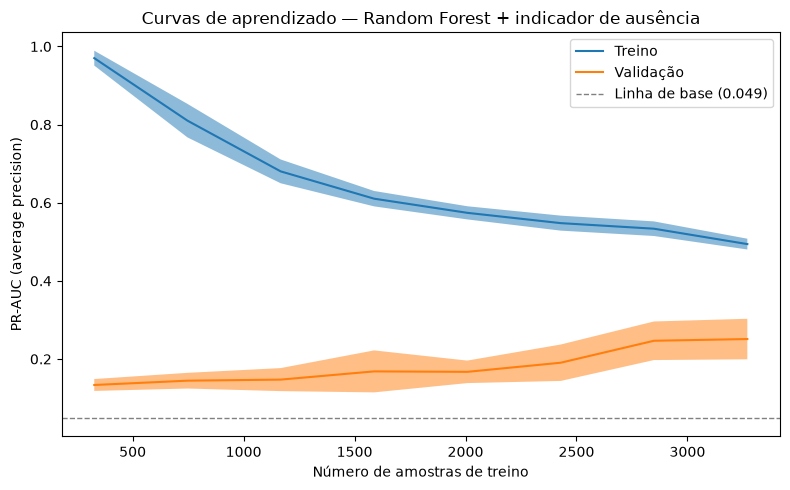
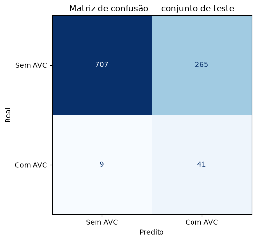
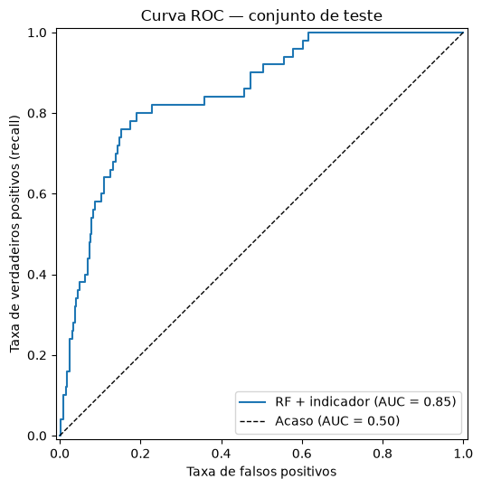
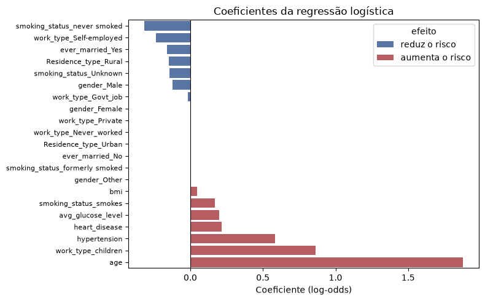
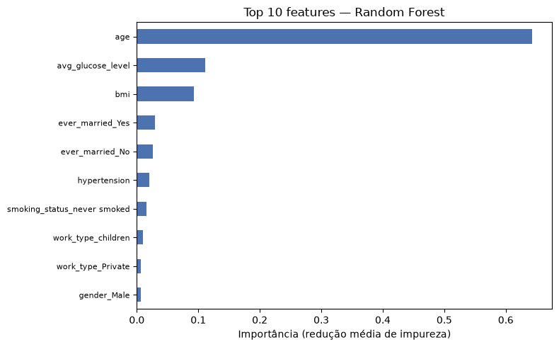
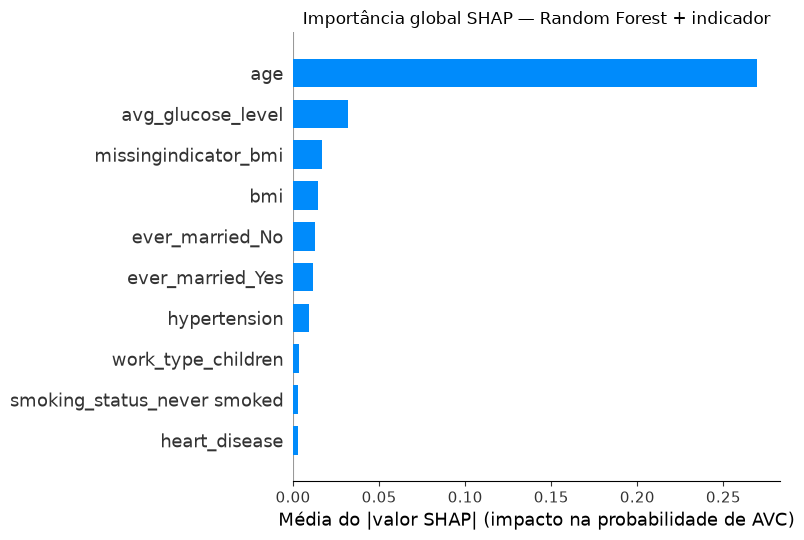
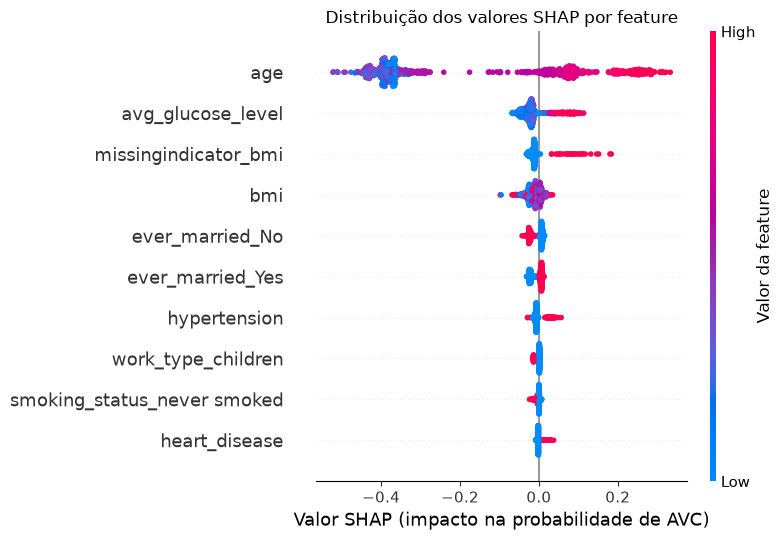
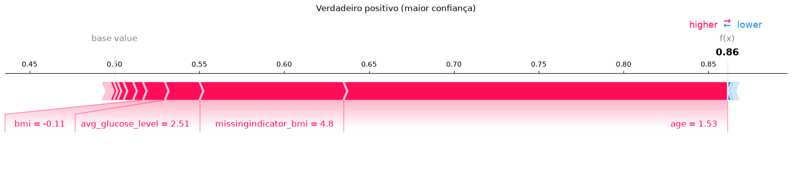
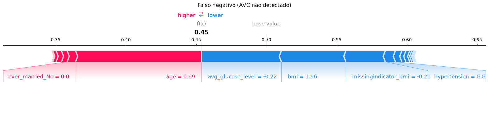
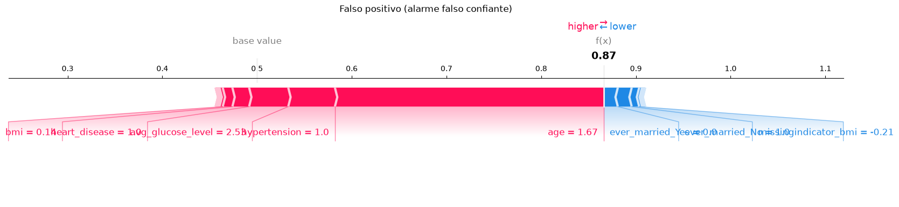

# Predição de AVC: modelagem, avaliação e explicabilidade

## Informações gerais

**Docente:** Humberto Sandman

**Integrantes:**

- Emily Britto -- emilybg@al.insper.edu.br
- Gabriel Chaves Aguiar -- gabrielca5@al.insper.edu.br

**Data da entrega:** 30/10/2026

**Dataset escolhido:** Stroke Prediction Dataset

**Tipo de problema:** Classificação binária

---

## Objetivo

Esta é a segunda etapa (APS2) do projeto de Machine Learning, dando
continuidade direta à [análise exploratória (APS1)](index.md). Ali foi
construído o pipeline de pré-processamento (imputação, encoding,
padronização) sobre o Stroke Prediction Dataset; aqui ele é reaproveitado
na modelagem: seleção de modelos, ajuste de
hiperparâmetros, avaliação no conjunto de teste e interpretação.

[Notebook completo (aps2_modelagem.ipynb)](https://github.com/emilybrtt/projeto-machine-learning/blob/main/aps2_modelagem.ipynb)

[Repositório no GitHub](https://github.com/emilybrtt/projeto-machine-learning)

---

## Setup: o pipeline da APS1

Repetimos aqui o carregamento, a divisão treino/teste e o pré-processador
construídos na APS1, para que o notebook seja autocontido. A divisão usa
`stratify=y` e o mesmo `random_state=42`, logo o conjunto de teste é
exatamente o mesmo da APS1 -- ele nunca é tocado antes da Seção 2. A única
diferença no pré-processador é `verbose_feature_names_out=False`, que só
encurta os nomes das features (`age` em vez de `numericas__age`) nos gráficos
de interpretação.

## Escolha da métrica de desempenho

Escolhemos a **PR-AUC** (*average precision*) como métrica principal.

A justificativa vem direto do que a APS1 mostrou: apenas **4,87%** dos
pacientes tiveram AVC. Nesse cenário:

- **Accuracy é inútil.** Um modelo que responde "sem AVC" para todo mundo
  acerta 95,1% das vezes e não detecta um único caso.
- **ROC-AUC é otimista.** A taxa de falsos positivos divide os alarmes
  falsos por todos os negativos, que são 95% da base. Um modelo pode ter taxa
  de falsos positivos baixa e, mesmo assim, gerar muito mais alarmes falsos
  do que acertos.
- **PR-AUC enxerga o problema.** Precision e recall ignoram os verdadeiros
  negativos, que são justamente a massa que não interessa aqui. A linha de
  base da PR-AUC é a própria prevalência (**0,0487**), então qualquer valor
  acima disso é ganho real sobre o acaso.

A PR-AUC é usada em **todas** as etapas: comparação dos modelos base,
`scoring` dos `GridSearchCV`, avaliação da mudança no pipeline e curvas de
aprendizado. A estratégia de validação é sempre `StratifiedKFold(n_splits=5,
shuffle=True, random_state=42)`, pelo mesmo motivo que a divisão
treino/teste foi estratificada: com 4,87% de positivos, um fold poderia
facilmente ficar sem casos suficientes.

!!! note "Métricas de classificação pedidas no enunciado"
    Accuracy, Precision, Recall, F1 e ROC-AUC também são reportadas na
    Seção 2, como pede a rubrica -- mas a seleção do melhor modelo em
    todas as etapas anteriores foi feita pela PR-AUC.

---

## 1. Seleção e implementação dos modelos

### 1.1 Os três modelos

| Modelo | Papel | Por que este |
|---|---|---|
| `DummyClassifier` | Piso de referência | Prediz respeitando a proporção das classes, sem olhar para as features. Qualquer modelo útil precisa superar isso. |
| `LogisticRegression` | Linear com regularização | Modelo de referência proposto na APS1. A regularização (L1/L2) controla o overfitting e, no caso do L1, zera coeficientes irrelevantes. |
| `RandomForestClassifier` | Ensemble de árvores | Captura interações e relações não lineares que a regressão logística não alcança, sem precisar que a gente as declare. |

Os três entram no **mesmo pipeline**, com o pré-processador da APS1 na
frente -- isso garante que a imputação e a padronização sejam aprendidas
apenas no fold de treino de cada partição da validação cruzada, sem
vazamento. Tanto a regressão logística quanto a floresta usam
`class_weight="balanced"`, resposta ao desbalanceamento já adotada na APS1:
o peso de cada classe fica inversamente proporcional à sua frequência,
então errar um caso de AVC custa cerca de 20 vezes mais do que errar um
caso negativo.

**Resultado da métrica para os três modelos (PR-AUC, validação cruzada):**

| Modelo | PR-AUC (média) | Desvio padrão |
|---|---:|---:|
| Dummy | 0,0488 | 0,0004 |
| Regressão Logística | 0,1933 | 0,0389 |
| Random Forest | 0,1691 | 0,0393 |

O Dummy fica em ~0,049, exatamente a prevalência, confirmando que a métrica
está calibrada. Os dois modelos reais ficam entre 0,17 e 0,19, cerca de **4x
acima do acaso**.
A regressão logística sai na frente da floresta na configuração padrão: uma
floresta sem limite de profundidade decora o treino, e com apenas 199 casos
positivos no treino há pouco sinal para generalizar. O desvio padrão entre
folds (~0,04) é alto em relação à média -- efeito do desbalanceamento, já que
cada fold de validação tem apenas ~40 casos positivos.

### 1.2 Seleção de hiperparâmetros

Usamos `GridSearchCV` com a mesma métrica e a mesma estratégia de validação
para a regressão logística e para a Random Forest:

- **Regressão logística:** `C` (força da regularização, escala log de
  0,001 a 100) e `l1_ratio` (0 = L2, 1 = L1), com solver `liblinear` por
  suportar as duas penalidades.
- **Random Forest:** `max_depth`, `min_samples_leaf` e `max_features` --
  os parâmetros que controlam o quanto a floresta pode decorar.
  `n_estimators=300` foi fixado, pois mais árvores não pioram o resultado,
  só custam tempo.

| Modelo | PR-AUC base | PR-AUC ajustado | Ganho |
|---|---:|---:|---:|
| Regressão Logística | 0,1933 | 0,1935 | +0,0002 |
| Random Forest | 0,1691 | 0,2079 | +0,0389 |

A regressão logística praticamente não se move com o ajuste (`C=1`, o
próprio valor padrão, com L1). A floresta, por outro lado, ganha de forma
clara quando podada (`max_depth=10`, `min_samples_leaf=20`) e passa à frente
da regressão logística -- confirmando que a floresta padrão estava decorando.

**O melhor modelo até aqui é a Random Forest ajustada.**

### 1.3 Mudança proposta no pipeline: sinalizar o `bmi` ausente

Na APS1, os 201 valores ausentes de `bmi` (3,93% da base) foram imputados
pela mediana. A imputação preenche o buraco, mas **apaga a informação de
que havia um buraco ali**. Investigando, apenas no conjunto de treino, se
essa ausência diz algo:

| | Pacientes | Casos de AVC | Taxa de AVC | Idade média |
|---|---:|---:|---:|---:|
| `bmi` presente | 3.918 | 162 | 4,1% | 42,9 |
| `bmi` ausente | 170 | 37 | **21,8%** | 53,3 |

A diferença é de cerca de **5x**, e os pacientes sem `bmi` são, em média,
10 anos mais velhos. A ausência não é aleatória: ela carrega sinal -- uma
explicação plausível é que pacientes em estado grave não tiveram o IMC
aferido, e esses são justamente os mais propensos a ter tido um AVC. Na
terminologia de Rubin[1], isso descarta a hipótese de ausência
completamente aleatória (MCAR): a ausência depende de outras variáveis, como
idade e desfecho. Se ela depende também do próprio IMC não medido (MNAR),
estes dados não permitem dizer. Para a modelagem, o que importa é que a
ausência é informativa e não pode ser tratada como ruído.

**A mudança:** ligar `add_indicator=True` no `SimpleImputer` das variáveis
numéricas. O imputer continua preenchendo com a mediana, mas passa a
adicionar uma coluna binária marcando quais linhas foram imputadas -- o
modelo deixa de ser cego para a ausência. A seleção de hiperparâmetros foi
refeita com a mesma grade, métrica e estratégia de validação, para que a
comparação fosse honesta.

| Pipeline | PR-AUC | Desvio padrão | Variação |
|---|---:|---:|---:|
| Pipeline da APS1 | 0,2079 | 0,0431 | -- |
| Pipeline + indicador | 0,2526 | 0,0512 | +0,0446 |

**Impacto:** a PR-AUC sobe de **0,2079** para **0,2526**, um ganho de
**+0,045** (cerca de **+21%** relativos) -- o maior ganho de todo o
trabalho, maior que o ajuste de hiperparâmetros dos dois modelos somado.
Vale registrar esse ganho em relação ao ruído: o desvio padrão entre folds
(0,043 sem o indicador e 0,051 com ele) é da mesma ordem do ganho, então o
resultado é promissor mas não é uma vitória esmagadora; seria preciso
repetir a validação com outras sementes para afirmar algo mais forte. Os hiperparâmetros ótimos também mudaram
(`max_depth` caiu de 10 para 5): com um preditor mais forte disponível, a
floresta precisa de menos profundidade.

**Melhor modelo final: Random Forest + indicador de ausência.**

### 1.4 Curvas de aprendizado

| Amostras de treino | PR-AUC treino | PR-AUC validação | Lacuna |
|---:|---:|---:|---:|
| 327 | 0,970 | 0,134 | 0,837 |
| 747 | 0,810 | 0,145 | 0,666 |
| 1.167 | 0,680 | 0,147 | 0,533 |
| 1.588 | 0,610 | 0,168 | 0,442 |
| 2.008 | 0,574 | 0,167 | 0,407 |
| 2.429 | 0,548 | 0,191 | 0,357 |
| 2.849 | 0,534 | 0,247 | 0,287 |
| 3.270 | 0,494 | 0,251 | 0,243 |

Duas conclusões: **(1)** a lacuna entre treino e validação é enorme e nunca
fecha -- mesmo com todos os 3.270 exemplos ela continua em 0,243, sinal de
variância alta que persiste apesar da poda, porque com apenas 199 casos
positivos no treino cada árvore consegue isolar casos individuais; **(2)** a curva de
validação ainda está subindo no último ponto, sem sinal de saturação -- ou
seja, mais dados ajudariam. O gargalo deste trabalho não é a escolha do
algoritmo nem o ajuste de hiperparâmetros, é a quantidade de casos de AVC
disponíveis.

---

## 2. Avaliação do melhor modelo no conjunto de teste

A partir daqui usamos o conjunto de teste, que não foi tocado em nenhuma
etapa anterior de modelagem -- nem na seleção de hiperparâmetros, nem na
decisão sobre o indicador de ausência.

| Métrica | Valor |
|---|---:|
| Accuracy | 0,732 |
| Precision (classe AVC) | 0,134 |
| Recall (classe AVC) | 0,820 |
| F1-score (classe AVC) | 0,230 |
| ROC-AUC | 0,849 |
| PR-AUC | 0,232 |

**41 dos 50** casos de AVC foram detectados, **9 passaram despercebidos**
(falsos negativos) e **265 pacientes sem AVC** foram sinalizados sem
necessidade (falsos positivos).

Três observações sobre os resultados:

1. **A accuracy de 0,732 é pior que a do modelo trivial (0,951), e isso é
   intencional.** O modelo troca accuracy por recall de propósito, por causa
   do `class_weight="balanced"` -- a troca certa aqui, já que um falso
   positivo custa um exame a mais e um falso negativo custa um AVC não
   prevenido.
2. **A distância entre ROC-AUC (0,849) e PR-AUC (0,232) é a razão de termos
   escolhido a PR-AUC.** Na curva ROC, o limiar de 0,5 vira um ponto com
   recall de 0,82 e taxa de falsos positivos de 0,27 (265 de 972 negativos),
   que parece razoável. Na precision, os mesmos 265 falsos positivos são
   comparados com apenas 41 acertos, e ela cai para 0,134: de cada 7 ou 8
   pacientes sinalizados, só um teve AVC. Reportar apenas o ROC-AUC daria a
   impressão de um modelo muito melhor do que ele é.
3. **O limiar de 0,5 não é obrigatório.** Deslocá-lo move o modelo ao longo
   da curva precision-recall sem retreinar nada. A escolha do ponto deveria
   vir do custo relativo entre exame desnecessário e AVC não prevenido --
   uma decisão clínica, não estatística[7].

---

## 3. Interpretação e explicabilidade

### 3.1 Modelo linear: os 3 coeficientes de maior magnitude

Usamos a regressão logística ajustada na Seção 1.2. Como as variáveis
numéricas foram padronizadas e as categóricas estão em 0/1, os coeficientes
são comparáveis entre si. Estão em escala de log-odds: nas numéricas, o
*odds ratio* `exp(coeficiente)` é o efeito de um desvio padrão a mais; nas
binárias, da passagem de 0 para 1.

1. **`age` (coeficiente +1,88, odds ratio 6,5).** Domina o modelo com
   folga -- mais que o dobro do segundo colocado. Cada desvio padrão de
   idade (22,6 anos) multiplica por 6,5 as chances de AVC. Bate com a
   literatura médica[4] e com os boxplots já mostrados na APS1.
2. **`work_type_children` (coeficiente +0,86).** Não deve ser lido como
   causal: crianças praticamente não têm AVC na base, e o coeficiente
   positivo é um artefato da colinearidade entre `work_type` e `age` --
   funciona como correção parcial da penalidade enorme que `age` já impõe
   para idades baixas.
3. **`hypertension` (coeficiente +0,59, odds ratio 1,8).** Hipertensão
   quase dobra as chances de AVC, mantidas as demais variáveis -- um fator
   de risco clínico bem estabelecido, recuperado pelo modelo com sinal e
   ordem de grandeza corretos.

### 3.2 Modelo ensemble: as 3 features de maior importância

Usamos a Random Forest ajustada na Seção 1.2, sem o indicador de ausência,
para compará-la com a regressão logística sobre as mesmas features; o
melhor modelo final é interpretado com SHAP na Seção 3.3. A importância
mede quanto cada feature contribuiu para reduzir a impureza dos nós, somada
sobre todas as árvores.

1. **`age` (0,643).** Sozinha responde por quase dois terços da importância
   total -- os dois modelos, com mecanismos completamente diferentes,
   concordam que idade é o preditor dominante.
2. **`avg_glucose_level` (0,111).** Faz sentido clínico (diabetes é fator
   de risco para AVC), mas a APS1 mostrou que essa variável é bimodal, com
   cauda longa de valores altos.
3. **`bmi` (0,093).**

!!! info "Uma armadilha a registrar"
    As três features mais importantes são exatamente as três variáveis
    **numéricas contínuas** -- não é coincidência. A importância por
    impureza é enviesada a favor de variáveis com muitos valores distintos,
    que oferecem mais pontos de corte possíveis[8]. `hypertension` aparecia
    como terceiro coeficiente mais forte na regressão logística, mas aqui
    fica em 6º lugar, com importância de apenas 0,021. Parte dessa
    divergência pode vir do viés, e a próxima seção confere com SHAP, que
    não depende da contagem de cortes.

### 3.3 SHAP: importância global e explicação de predições individuais

Os valores SHAP vêm da teoria dos jogos cooperativos: distribuem a
diferença entre a predição e o valor médio entre as features[2]. Em vez de
somar a redução de impureza de cada corte, medem quanto cada feature desloca
a predição, o que evita o viés de medição da seção anterior, e permitem
explicar uma predição individual, não só a média.

O valor base sai perto de 0,50, e não da prevalência de 4,87%, por causa do
`class_weight="balanced"`: o peso extra dos positivos faz a floresta
enxergar classes equilibradas. Por isso as "probabilidades" deste modelo
servem para ordenar pacientes, mas não devem ser lidas como risco absoluto.

| Feature | SHAP médio absoluto |
|---|---:|
| `age` | 0,2694 |
| `avg_glucose_level` | 0,0317 |
| `missingindicator_bmi` | 0,0168 |
| `bmi` | 0,0146 |
| `ever_married_No` | 0,0129 |
| `ever_married_Yes` | 0,0114 |
| `hypertension` | 0,0093 |

A concentração em `age` fica ainda mais evidente: ela sozinha pesa **8,5
vezes** mais que a segunda colocada. A novidade em relação à Seção 3.2 é o
`missingindicator_bmi`, que só existe neste modelo: ele aparece em
terceiro, um pouco à frente do próprio `bmi` (0,0168 contra 0,0146) -- saber
que o IMC não foi medido vale tanto, para o modelo, quanto o valor do IMC.
É o retrato quantitativo do ganho obtido com a mudança da Seção 1.3.

`hypertension` continua lá embaixo (7º lugar, 0,0093), então o viés da
importância por impureza não explica sozinho a divergência com a regressão
logística. Uma leitura plausível é que a floresta, por conseguir modelar a
idade de forma não linear, extrai dela boa parte do sinal que a logística
atribui à hipertensão, já que as duas andam juntas.

#### Explicação de 3 predições individuais

Escolhemos o caso de maior probabilidade predita em três grupos: verdadeiros
positivos, falsos negativos e falsos positivos. Nos force plots, os valores
das features estão na escala padronizada que o modelo enxerga; o indicador
de ausência também passa pelo `StandardScaler`, por isso aparece como 4,8
quando o IMC falta e -0,21 quando está presente.

**Verdadeiro positivo -- homem, 78 anos, doença cardíaca, glicose 219,8,
`bmi` ausente. Probabilidade predita: 0,861.** A segunda maior contribuição
positiva não é um fator clínico -- é o fato de o IMC deste paciente não ter
sido registrado (`missingindicator_bmi`: +0,0848), pesando quatro vezes
mais que a glicose de 219,8 mg/dL, e a doença cardíaca nem aparece no
top 3.

**Falso negativo -- homem, 59 anos, sem hipertensão, sem doença cardíaca,
glicose 96,2, IMC 44,1. Probabilidade predita: 0,454 (escapou por 0,046).**
A idade empurrou para cima (+0,090), mas a glicose normal e o IMC puxaram
para baixo com força somada um pouco maior (-0,103), e foi isso que deixou
a probabilidade abaixo do limiar. Chama atenção que o IMC de 44,1 (obesidade grave)
tenha *reduzido* o risco predito -- o modelo não aprendeu uma relação
confiável para `bmi`, provavelmente por haver poucos exemplos de AVC na
cauda alta da distribuição.

**Falso positivo -- homem, 81 anos, hipertensão, doença cardíaca, glicose
220,6, IMC 30,0. Probabilidade predita: 0,866.** O modelo identificou um
perfil de risco real (três fatores clássicos, na ordem esperada); o AVC
simplesmente não aconteceu. Para uma ferramenta de triagem, esse erro é
aceitável -- diferente, em custo clínico, do falso negativo anterior.

**Comparando os três casos:** `age` é a maior contribuição nos três, e nos
dois de alta confiança ela é 2,7 e 5,8 vezes maior que a segunda
colocada; os demais fatores ajustam a margem da decisão.

---

## 4. Discussão crítica

### 4.1 Duas limitações do melhor modelo

**(1) O ganho do indicador de ausência pode não transferir para outro
hospital.** O maior ganho de desempenho do trabalho (+21% de PR-AUC) veio do
`missingindicator_bmi`, terceira feature mais influente no SHAP. Mas "o IMC
não foi registrado" não é um fator de risco -- é um reflexo de como estes
dados foram coletados. Em um
hospital diferente, com outro protocolo de registro, essa coluna
significaria outra coisa ou nada: o modelo aprendeu algo que não transfere.
Pior, se o hospital melhorar o preenchimento do cadastro, o desempenho do
modelo cai sem que nada tenha mudado nos pacientes -- uma dependência
frágil e invisível em produção. É um exemplo do fenômeno de *dataset
shift*, bem documentado na literatura de IA clínica[3].

**(2) Na prática, o modelo é em grande parte um detector de idade.** `age`
tem SHAP médio 8,5 vezes maior que a segunda feature do melhor modelo. Para
medir o ganho real sobre uma regra simples do tipo "encaminhe todo paciente
com 60 anos ou mais", cruzamos as predições do teste com a idade (análise
feita depois da escolha do modelo, sem alterar nenhuma decisão anterior):

| Faixa etária | Pacientes | Casos de AVC | Detectados |
|---|---:|---:|---:|
| 60 anos ou mais | 272 | 38 | 38 |
| Menos de 60 anos | 750 | 12 | 3 |

| Critério | Recall | Precision | Sinalizados |
|---|---:|---:|---:|
| RF + indicador (limiar 0,5) | 0,82 | 0,134 | 306 |
| Regra: 60 anos ou mais | 0,76 | 0,140 | 272 |

Contra a regra, o modelo ganha 6 pontos de recall ao custo de 34
encaminhamentos a mais. Usada como escore, a idade sozinha já tem PR-AUC de
0,197, contra 0,232 do modelo. Boa parte do desempenho vem de ordenar
pacientes por idade, e os pacientes mais jovens com AVC, que seriam os mais
beneficiados por uma triagem automatizada, são justamente os que o modelo
perde (3 de 12). **O valor clínico está concentrado exatamente onde o
modelo é mais fraco.** Com só 12 casos abaixo de 60 anos no teste, as
proporções exatas são frágeis, mas a direção da diferença é nítida. A
dominância da idade em si é consistente com a epidemiologia do AVC, em que
ela é apontada como o fator de risco de maior peso populacional[4].

### 4.2 Duas limitações dos dados

**(1) O dataset não tem dimensão temporal.** Cada linha é uma fotografia:
as features e o `stroke` estão no mesmo instante. Não se sabe se a
hipertensão foi diagnosticada antes ou depois do AVC, nem se a glicose foi
medida na internação causada pelo próprio AVC -- o que inviabiliza qualquer
afirmação causal e abre espaço para **vazamento temporal**, em que parte do
que o modelo usa como "preditor" pode ser consequência do desfecho. Um
modelo de predição de risco precisaria de features medidas comprovadamente
*antes* do evento. Esse risco é descrito em detalhe na literatura de
detecção de vazamento de dados[5].

**(2) Faltam fatores de risco conhecidos, e os que existem são
grosseiros.** A base não traz colesterol, função renal, fibrilação atrial,
AVC ou ataque isquêmico transitório anteriores, nem a medicação em uso.
Vários desses fatores aparecem na literatura como determinantes importantes
do AVC[4]. As variáveis presentes são resumos: `hypertension` e
`heart_disease` são apenas sim/não, sem gravidade nem controle;
`smoking_status` não registra intensidade; e o próprio `stroke` não
distingue AVC isquêmico de hemorrágico, que têm perfis de risco diferentes.
Isso impõe um teto ao desempenho que nenhum ajuste de modelo ultrapassa e
ajuda a explicar por que a idade, única variável contínua com relação forte
com o desfecho, domina as interpretações da Seção 3.

### 4.3 Duas ações para operacionalização e manutenção

**(1) Monitorar a distribuição das entradas, não só o desempenho.** O
desfecho de AVC leva meses ou anos para ser observado, então esperar pelos
rótulos para descobrir que o modelo degradou significa descobrir tarde
demais. A ação concreta é registrar, a cada lote de predições, a
distribuição das features de entrada e compará-la com a do treino -- com
atenção especial à **taxa de ausência do `bmi`**, pela dependência descrita
em 4.1. Um alarme automático quando essa taxa se afastasse da observada no
treino (4,2%, 170 de 4.088 pacientes) detectaria o problema imediatamente, sem precisar de um
único rótulo novo. Monitorar a distribuição de entrada é recomendação
central tanto na literatura de *dataset shift* em saúde[3] quanto na de
manutenção de sistemas de ML em produção[6].

**(2) Separar a escolha do limiar do treinamento do modelo, e revisá-la
periodicamente.** Hoje usa-se o limiar padrão de 0,5, sem justificativa
clínica. O limiar deveria ser um parâmetro de configuração definido pela
equipe médica a partir da capacidade de atendimento disponível: quantos
encaminhamentos por mês o serviço comporta define onde cortar na curva
precision-recall. Mantido fora do modelo, esse valor pode ser recalibrado
quando a capacidade mudar, sem retreinar nada -- combinado com revisão
periódica (semestral) com dados novos rotulados, isso mantém o sistema útil
sem exigir reimplantação completa a cada ajuste. Essa separação entre o
modelo (que estima probabilidades) e o limiar de decisão (que reflete
custos e capacidade operacional) segue o princípio de análise
custo-sensível discutido na literatura de ciência de dados aplicada[7].

---

## 5. Referências

**Dataset**

- fedesoriano. *Stroke Prediction Dataset*. Kaggle, 2021. Disponível em:
  <https://www.kaggle.com/datasets/fedesoriano/stroke-prediction-dataset>.
  Acesso em: outubro de 2026.

**Bibliotecas e documentação técnica**

- PEDREGOSA, F. et al. Scikit-learn: Machine Learning in Python. *Journal
  of Machine Learning Research*, v. 12, p. 2825-2830, 2011.
- LUNDBERG, S. M.; LEE, S.-I. A Unified Approach to Interpreting Model
  Predictions. In: *Advances in Neural Information Processing Systems
  (NeurIPS)*, v. 30, 2017. (SHAP)

**Referências metodológicas e da discussão crítica**

Os números entre colchetes ao longo das Seções 1.3, 2, 3 e 4 remetem a
esta lista:

1. RUBIN, D. B. Inference and Missing Data. *Biometrika*, v. 63, n. 3,
   p. 581-592, 1976.
2. LUNDBERG, S. M.; LEE, S.-I. A Unified Approach to Interpreting Model
   Predictions. In: *Advances in Neural Information Processing Systems
   (NeurIPS)*, v. 30, 2017.
3. FINLAYSON, S. G. et al. The Clinician and Dataset Shift in Artificial
   Intelligence. *New England Journal of Medicine*, v. 385, n. 3, p.
   283-286, 2021.
4. GBD 2019 STROKE COLLABORATORS. Global, Regional, and National Burden
   of Stroke and Its Risk Factors, 1990-2019: A Systematic Analysis for
   the Global Burden of Disease Study 2019. *The Lancet Neurology*, v. 20,
   n. 10, p. 795-820, 2021.
5. KAUFMAN, S.; ROSSET, S.; PERLICH, C. Leakage in Data Mining:
   Formulation, Detection, and Avoidance. *ACM Transactions on Knowledge
   Discovery from Data*, v. 6, n. 4, p. 1-21, 2012.
6. SCULLEY, D. et al. Hidden Technical Debt in Machine Learning Systems.
   In: *Advances in Neural Information Processing Systems (NeurIPS)*, v.
   28, 2015.
7. PROVOST, F.; FAWCETT, T. *Data Science for Business*. Sebastopol:
   O'Reilly Media, 2013.
8. STROBL, C. et al. Bias in Random Forest Variable Importance Measures:
   Illustrations, Sources and a Solution. *BMC Bioinformatics*, v. 8,
   n. 25, 2007.
